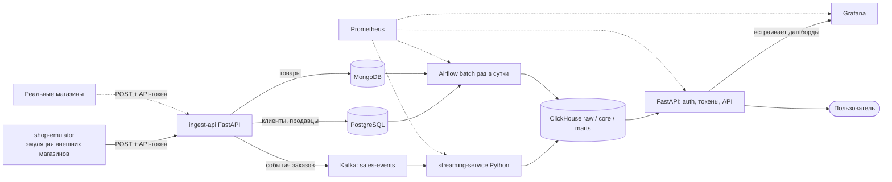

# Техническое задание: Система мониторинга продаж

## 1. Описание проекта

**Система мониторинга и аналитики продаж**

**Цель:** построить сквозной аналитический пайплайн. Внешние магазины присылают в нашу систему справочные данные и события заказов через HTTP POST. Система раскладывает справочных данные по хранилищам (PostgreSQL, MongoDB), события заказов кладёт в Kafka, приводит всё к единой модели в ClickHouse и отдаёт витрины через дашборды Grafana и веб-API.

Внешние магазины в рамках проекта эмулирует сервис `shop-emulator`. Реальный магазин подключается тем же способом: токен и POST-запросы.

---

## 2. Источники данных и хранилища

Единственный вход данных в систему: *внешние магазины*, которые шлют данные в `ingest-api` по HTTP.

| Что присылает магазин | Куда кладёт ingest-api | Роль |
| --- | --- | --- |
| Клиенты, продавцы | PostgreSQL | Реляционные справочники |
| Товары (категории, цены, себестоимость, атрибуты) | MongoDB | Каталог с гибкой схемой |
| События заказов | Kafka (`sales-events`) | Поток фактов |

Магазин (`shops`), пользователи и API-токены создаются администратором, магазины сами эти данные не присылают.

### 2.1 PostgreSQL

| Таблица | Поля |
| --- | --- |
| `shops` | `shop_id`, `name`, `commission_rate`, `currency`, `created_at`, `updated_at` |
| `clients` | `client_id`, `shop_id`, `full_name`, `email`, `city`, `segment`, `created_at`, `updated_at` |
| `sellers` | `seller_id`, `shop_id`, `full_name`, `region`, `hired_at`, `updated_at` |
| `users` | `user_id`, `login`, `password_hash`, `role`, `shop_id` (NULL для admin/analyst/tech), `is_active` |
| `api_tokens` | `token_id`, `token_hash`, `shop_id`, `scopes`, `expires_at`, `revoked` |

Запись `clients` и `sellers` идемпотентна: upsert по `(shop_id, client_id)` и `(shop_id, seller_id)`, обновление только если `updated_at` новее.

### 2.2 MongoDB, коллекция `products`

```json
{
  "_id": "ObjectId",
  "shop_id": 1,
  "product_id": "string",
  "name": "string",
  "category": "string",
  "subcategory": "string",
  "price": 0.0,
  "cost_price": 0.0,
  "currency": "RUB",
  "attributes": { "brand": "string", "unit": "string" },
  "updated_at": "ISODate"
}
```

Upsert по `(shop_id, product_id)`. `product_id` уникален в рамках магазина.

### 2.3 Kafka, топик `sales-events`

- Формат JSON, ключ сообщения `order_id`.
- Единый канонический формат. В Kafka попадают только события, прошедшие валидацию в `ingest-api`.

```json
{
  "event_id": "uuid",
  "event_type": "order_created | order_paid | order_cancelled | order_returned",
  "order_id": "string",
  "shop_id": 1,
  "event_ts": "2026-10-06T10:15:00Z",
  "client_id": 12345,
  "seller_id": 67,
  "items": [
    { "product_id": "p-100", "qty": 2, "price": 599.0, "discount": 0.1 }
  ],
  "payment_type": "card",
  "total_amount": 1078.2
}
```

### 2.4 Форматы справочных данных во входящих запросах

Пакеты (batch) по одному типу сущности, `shop_id` берётся из токена и проверяется на совпадение с телом запроса:

```json
{
  "shop_id": 1,
  "items": [
    { "client_id": 12345, "full_name": "...", "email": "...", "city": "...", "segment": "...", "updated_at": "2026-10-06T10:00:00Z" }
  ]
}
```

Для `sellers` и `products` структура аналогична и соответствует полям из 2.1 и 2.2.

---

## 3. Архитектура решения



`ingest-api` и API для витрин — один сервис FastAPI с разными роутерами.

**Слои:**

1. **Входящие данные**: HTTP POST от внешних магазинов (эмулятор или реальные).
2. **Приём и маршрутизация** (`ingest-api`): проверка токена и прав, валидация, запись справочных данных в PostgreSQL и MongoDB, публикация событий заказов в Kafka.
3. **Raw**: сырые события и срезы справочников в ClickHouse (`raw_sales_events`, `raw_products` и т.д.). 
4. **Processing**
   - *Streaming*: Python-сервис читает `sales-events`, дедуплицирует по `event_id`, обогащает справочниками (клиент, продавец, товар и себестоимость) и пишет в `fact_sales`. Если справочная запись не найдена, событие уходит в таблицу `raw_dead_letter` с причиной и учитывается в `processing_errors_total`.
   - *Batch*: Airflow DAG раз в сутки инкрементально (по `updated_at`) переносит справочники из PostgreSQL и MongoDB в измерения ClickHouse и запускает проверки качества.
5. **Core + Marts (ClickHouse)**: звезда и агрегированные витрины.
6. **API**: FastAPI.
7. **Мониторинг** (опционально): Prometheus + Grafana.

---

## 4. Модель данных ClickHouse (звезда)

**Измерения:**

`dim_shop`

`dim_client`

`dim_seller`

`dim_product`

`dim_date`

**Факт `fact_sales`** (одна строка на позицию заказа и событие)

- Поля: `order_id`, `line_no`, `event_id`, `shop_id`, `order_ts`, `client_id`, `seller_id`, `product_id`, `qty`, `price`, `discount`, `revenue`, `cost`, `commission`, `profit`, `status`, `payment_type`.
- Движок: `ReplacingMergeTree`, партиционирование по месяцу, сортировка `(shop_id, order_ts, order_id, line_no)`.

**Формулы:**

- `revenue = qty × price × (1 − discount)`
- `cost = qty × cost_price`
- `commission = revenue × commission_rate`
- `profit = revenue − cost − commission`
- Возвраты и отмены записываются отдельными строками со статусом и отрицательными значениями.

**Витрины**

- `mart_daily_shop`: выручка, себестоимость, прибыль, заказы, средний чек по магазину и дню.
- `mart_daily_product`: то же по товару, бренду, категории (основа для топов).
- `mart_daily_seller`: вклад продавцов.
- `mart_daily_segment`: средний чек по сегменту клиента и региону.

---

## 5. Эмулятор внешних магазинов (shop-emulator)

Сервис в docker-compose. Играет роль внешних систем магазинов и работает только через публичный HTTP-интерфейс `ingest-api`, напрямую в БД и Kafka не пишет.

- Конфигурация: число магазинов (по умолчанию 3), частота событий, сезонность (дневные и недельные пики), объёмы справочников. У каждого магазина свой API-токен.
- **Первичная загрузка справочных данных:** при старте эмулятор отправляет клиентов, продавцов и товары через `POST /api/v1/ingest/clients`, `/sellers`, `/products`.
- **Периодическое обновление справочных данных:** раз в несколько часов отправляется небольшой пакет изменённых записей, чтобы проверять инкрементальную загрузку по `updated_at`.
- **Поток заказов:** непрерывная отправка событий через `POST /api/v1/ingest/orders` с жизненным циклом `order_created` → `order_paid` → при необходимости `order_cancelled` / `order_returned`.
- **Режимы «грязных данных»** (включаются флагами): дубли событий, опоздавшие события, возвраты, некорректные записи (для проверки валидации и ответов API).

---

## 6. Приём данных (ingest-api)

- `POST /api/v1/ingest/clients`, `/sellers`, `/products`: загрузка справочных данных, добавление в PostgreSQL или MongoDB.
- `POST /api/v1/ingest/orders`: события в каноническом формате; после валидации публикуются в Kafka с ключом `order_id`.
- Авторизация по API-токену с правами `ingest:master` и `ingest:orders`. `shop_id` в теле должен совпадать с `shop_id` токена, иначе `403`.
- Магазин регистрируется администратором: создаётся запись в `shops` и выдаётся API-токен.

---

## 7. Роли, токены и API

### Роли

| Роль | Доступ |
| --- | --- |
| `admin` | Всё, управление магазинами, пользователями и токенами |
| `analyst` | Данные всех магазинов, только чтение |
| `shop_owner` | Данные только своего магазина |
| `tech` | Технические дашборды и метрики |

### Токены

JWT для пользователей (login), API-токены с правами для внешних систем.

### Эндпоинты

| Метод | Путь | Описание |
| --- | --- | --- |
| POST | `/api/v1/auth/login`, `/api/v1/auth/logout` | Сессия |
| GET | `/api/v1/auth/me` | Профиль и роль |
| GET | `/api/v1/sales/summary` | KPI за период (`from`, `to`, `shop_id`, `brand`, `category`) |
| GET | `/api/v1/sales/timeseries` | Динамика выручки/прибыли по дням |
| GET | `/api/v1/sales/by-seller` | Продажи по продавцам (сортировка, пагинация) |
| GET | `/api/v1/sales/top-products` | Топ-N товаров (`limit`, `order_by`) |
| GET | `/api/v1/filters` | Значения фильтров (магазины, бренды, категории) |
| POST | `/api/v1/admin/shops`, `/api/v1/admin/tokens` | Управление магазинами и токенами |
| POST | `/api/v1/ingest/clients`, `/sellers`, `/products` | Приём справочных данных от магазинов |
| POST | `/api/v1/ingest/orders` | Приём событий заказов от магазинов |
| GET | `/metrics` | Prometheus (опционально) |
| GET | `/docs` | Swagger |

---

## 8. Дашборды Grafana

- **Sales Overview:** переменные дашборда (период, магазин, бренд, категория); панели KPI (выручка, себестоимость, прибыль, заказы, средний чек); график динамики; топ товаров и брендов; разбивка по категориям.
- **Sellers:** рейтинг и вклад продавцов.
- **System Health** (для `tech`): лаг консьюмера Kafka, ошибки обработки, статус DAG, ошибки вставки в ClickHouse.

---

## 9. Мониторинг (опционально)

Метрики:

- `kafka_consumer_lag`
- `processing_errors_total`
- коды ответов FastAPI
- длительность DAG
- ошибки вставки ClickHouse

---

## 10. Нефункциональные требования

- Задержка от приёма события в `ingest-api` до витрины не более 1 минуты.
- Батч-обновление справочников не более 15 минут.
- Идемпотентность: повторная доставка события или повторная отправка справочных данных не меняет витрины.
- Изоляция данных между магазинами.
- Запуск одной командой.

---

## 11. Этапы разработки

**Этап 1: сквозной поток**

1. Инфраструктура: Postgres, MongoDB, Kafka, ClickHouse, Grafana.
2. `ingest-api` (приём справочных данных и заказов, проверка API-токена).
3. `shop-emulator`: загрузка справочных данных и поток заказов через POST.
4. DDL: raw, звезда, витрины.
5. streaming-service (Kafka → ClickHouse) с дедупликацией и обогащением.
6. Создание дашборда Grafana (KPI и динамика).

**Этап 2: батч и доступ**

7. Airflow DAG справочников.
8. FastAPI: auth, роли, токены, эндпоинты витрин, админские эндпоинты.
9. Фильтры по магазину, бренду, категории; изоляция по `shop_id`.

**Этап 3: расширение**

10. Prometheus и технический дашборд.
11. Документация, схемы, README.

---

## 12. Критерии приёмки

- Все сервисы поднимаются одной командой без ручных правок.
- Эмулятор отправляет данные только через `ingest-api`: клиенты и продавцы оказываются в PostgreSQL, товары в MongoDB, события заказов в Kafka.
- Данные из PostgreSQL, MongoDB и Kafka видны в ClickHouse в согласованном виде.
- Дашборд показывает выручку, себестоимость, прибыль с фильтрами по дню, магазину, бренду и категории.
- Повторная отправка одного и того же события или пакета справочных данных не искажает суммы.
- Запрос с токеном одного магазина с чужим `shop_id` отклоняется.
- `shop_owner` не может получить данные чужого магазина.
- Эндпоинты `/sales/*` возвращают корректные агрегаты, `/docs` отражает все эндпоинты.
- Новый тестовый магазин подключается через токен без правок ядра.

---